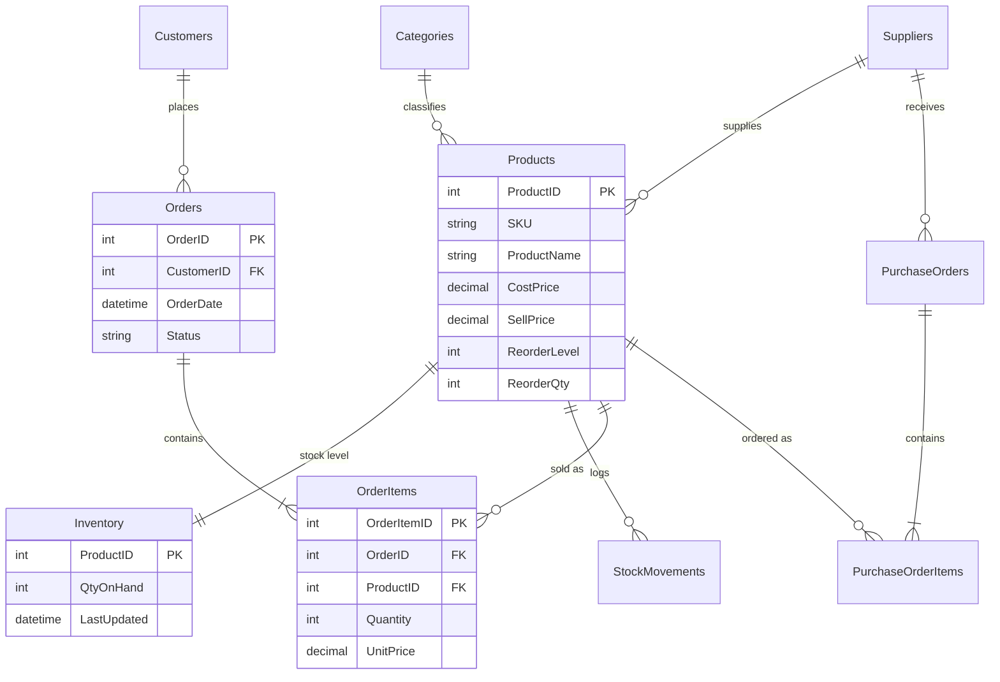

# RetailStock: Inventory & Sales Database (MS SQL Server)

## The problem
A small retailer loses money in two ways: **stockouts** (lost sales) and **overstock** (cash tied up in products that don't sell). This database tracks products, stock levels, sales and supplier orders so that:

- low stock is flagged automatically and purchase orders can be generated,
- stock updates itself whenever a sale is recorded (and overselling is blocked),
- slow-moving products and the capital tied up in them are easy to find,
- sales trends and best sellers can be reported with plain SQL.

## Tech
Microsoft SQL Server (T-SQL), SSMS / Azure Data Studio.

## Live dashboard
https://rabomatjokotja777.github.io/retailstock-mssql/

## Entity relationship diagram

## Design decisions
- **3NF schema**: categories, suppliers and customers live in their own tables.
- **`UnitPrice` stored on `OrderItems`**: historical sales keep the price at the time of sale even if the product price changes.
- **`Inventory` separate from `Products`**: stock changes constantly, product details rarely.
- **`StockMovements` audit log**: every change in stock is traceable.
- **CHECK constraints** enforce business rules (no negative stock, valid statuses, positive quantities).
- **Trigger `trg_OrderItems_AfterInsert`** deducts stock on sale; the `QtyOnHand >= 0` check rolls back sales that would oversell.
- **Indexes** are on the columns that reports filter and join on (see comments in `schema.sql`).

## What's inside
| File | Purpose |
|---|---|
| `schema.sql` | Tables, constraints, indexes, trigger, views, stored procedure |
| `seed_data.sql` | Sample data: 36 products, 40 customers, ~640 orders over 13 weeks |
| `queries/dashboard_queries.sql` | The queries behind every dashboard panel, plus window-function examples |
| `docs/index.html` | Static dashboard, published with GitHub Pages |
| `gen.py` | Script that generated the sample data and dashboard figures |

It shows revenue KPIs, weekly revenue, revenue by category, top products, items that need reordering and slow-moving stock.

## Key objects
- `vw_ReorderNeeded`: products at or below their reorder level
- `vw_SlowMovers`: products with no sales in 90 days, with capital tied up
- `usp_GenerateReorders`: creates one purchase order per supplier for low-stock items, skipping products already on order

